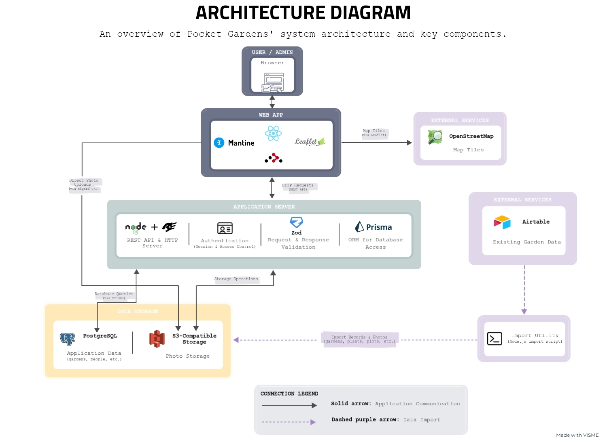
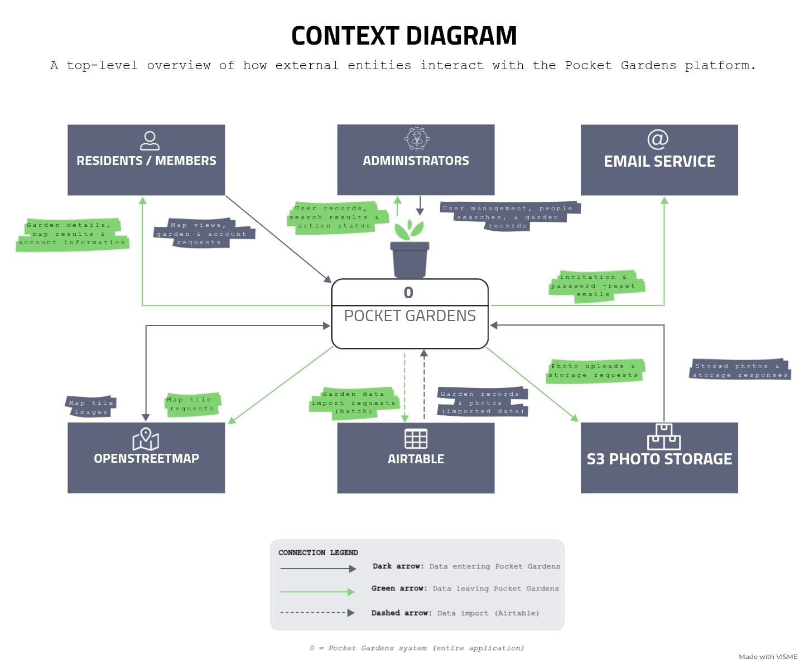

<h3 align="center" style="font-size: 2.1em; font-weight: bolder;">🌱 Pocket Gardens</h3>

<p align="center">
  A community gardening platform helping San Francisco residents grow and care for urban green spaces.
  <br />
  <br />
  <a href="https://github.com/sfbrigade/pocket-gardens/issues/new">Report Bug</a>
  ·
  <a href="https://github.com/sfbrigade/pocket-gardens/issues/new">Request Feature</a>
</p>

<!-- ABOUT THE PROJECT -->

## 📖 About the Project

**Pocket Gardens** is an open-source web application designed to help people discover and care for neighborhood gardens throughout San Francisco. By making these spaces easier to find and maintain, the project hopes to encourage more people to take part in urban gardening.

Even a small garden can make a difference in a neighborhood. It can catch someone's attention, spark a conversation, or inspire others to get involved and take pride in their neighborhood. But keeping these gardens growing takes time, people, and coordination. As more people pitch in, keeping track of plants, volunteers, and maintenance can become a challenge.

Pocket Gardens brings all of this information together in one place, making it easier for organizers to coordinate everyone's efforts. By taking some of the work out of organizing, the project hopes to encourage more people to get involved and work together to turn overlooked spaces into gardens.

### ✨ Features

The following features represent existing functionality and core capabilities being developed for the platform.

- **Garden Discovery:** Explore neighborhood garden plots through an interactive map and view garden information.
- **Garden Management:** Organize garden plot information and support tracking gardens throughout their lifecycle.
- **Plant Library:** Browse and manage plant information associated with community gardens.
- **People Management:** Provide administrative tools for viewing and searching people records, with additional functionality under development.
- **Maintenance Tracking:** Record and manage garden maintenance activities.
- **Member Authentication:** Support secure member access, with passwordless authentication planned for the MVP.

<!-- CONTRIBUTIONS -->

## 🌿 My Contributions

I've been interested in sustainability for a long time, and gardening has become one of my creative outlets. When I discovered Pocket Gardens through [SF Civic Tech](https://www.sfcivictech.org/), I was drawn to the opportunity to bring those interests together through programming while contributing to a project that adds more greenery and character to San Francisco.

As a volunteer software engineer, I work on full-stack features that help organizers manage people and garden information. My contributions so far include:

- **People Directory:** Built a React and Mantine interface for viewing people records, with search and pagination to help administrators find and navigate information more easily.
- **REST API:** Developed a Fastify endpoint using Prisma and PostgreSQL to retrieve people records, with Zod validation and admin authorization to ensure requests are validated and sensitive information is accessible only to administrators.
- **Frontend Integration:** Connected the people directory to the backend API, using URL parameters to manage search and pagination and adding navigation links for individual person records.
- **Automated Testing:** Created API tests using sample people records to verify that the endpoint returns the expected results, helping catch regressions as the application evolves.

**Merged Pull Request:** [#39 – Add Admin People List with Search](https://github.com/sfbrigade/pocket-gardens/pull/39)

<!-- TECH STACK -->

## 🛠️ Tech Stack

| **Front-End** | **Back-End** |
| :---: | :---: |
| [![JavaScript][JavaScript.com]][JavaScript-url] | [![Node.js][Node.js.com]][Node.js-url] |
| [![React][React.com]][React-url] | [![Fastify][Fastify.com]][Fastify-url] |
| [![React Router][ReactRouter.com]][ReactRouter-url] | [![Prisma][Prisma.com]][Prisma-url] |
| [![Mantine][Mantine.com]][Mantine-url] | [![PostgreSQL][PostgreSQL.com]][PostgreSQL-url] |
| [![Vite][Vite.com]][Vite-url] | [![Zod][Zod.com]][Zod-url] |


**Development & Infrastructure:** [Docker](https://www.docker.com/), [GitHub Actions](https://github.com/features/actions), [RustFS](https://rustfs.com/), [Airtable](https://www.airtable.com/)

## 🏗️ Architecture

### System Architecture

The diagram below shows how the different parts of Pocket Gardens work together, from the frontend and backend to the database, photo storage, and other services.



### System Context

The context diagram illustrates how residents and administrators interact with Pocket Gardens and how the platform exchanges data with external services for mapping, photo storage, email notifications, and garden data imports.



### 🗄️ Database Schema

Pocket Gardens uses PostgreSQL and Prisma to organize and store information about gardens, plants, volunteers, user accounts, and maintenance activities. The database contains 17 models that define how this information is stored and connected.

For a closer look at the tables, fields, and relationships, see the [Prisma Schema](server/prisma/schema.prisma).

### 🔌 API Routes

The backend uses Fastify to handle API requests, with Swagger and Scalar providing an interactive reference where you can explore endpoints, view request and response details, and test requests.

The API reference is available at `http://localhost:3333/api/reference` when the application is running through Docker Compose.

## 🚀 Getting Started

### One-time Setup

1. On Github, "Fork" this git repo to your own account so that you have your own copy.

   Read more about "forking" here:  
   https://docs.github.com/en/free-pro-team@latest/github/getting-started-with-github/fork-a-repo

2. Clone YOUR copy of the git repo to a "local" directory (on your computer), then change
   into the directory.

   ```
   git clone https://github.com/YOUR_ACCOUNT_ID/pocket-gardens.git
   cd pocket-gardens
   ```

3. Install Docker Desktop: https://www.docker.com/products/docker-desktop

   1. Windows users see notes below...

4. Open a command-line shell, change into your repo directory, and execute these commands:

   ```
   docker compose pull
   docker compose up
   ```

   It will take a while the first time you run these commands to download the "images" to
   run the web application code in Docker "containers". When you see messages that look
   like this, the server is running:

   ```
   pocket-gardens-server-1       | 5:31:23 PM client.1 |    VITE v4.3.9  ready in 327 ms
   pocket-gardens-server-1       | 5:31:23 PM client.1 |    ➜  Local:   http://localhost:3333/
   ```

5. Now you should be able to open the web app in your browser at: http://localhost:3333/

6. Open a new tab or window of your shell, change into your repo directory as needed, and execute this command:

   ```
   docker compose exec server bash -l
   ```

   This will log you in to the running server container, as if you were connecting to a different machine over the Internet.
   Once you're logged in, you will be in a new shell for the container where you can run the following command:

   ```
   bin/create-admin.js Firstname Lastname email password
   ```

   Put in your name and email address and a password. This will create a first admin user in the database.

7. To stop the server, press CONTROL-C in the window with the running server.
   If it is successful, you will see something like this:

   ```
   Killing pocket-gardens_db_1           ... done
   Killing pocket-gardens_server_1       ... done
   Killing pocket-gardens_mailcatcher_1  ... done
   ```

   If it is not successful, you may see something like this:

   ```
   ERROR: Aborting.
   ```

   If you get an error, the server may still be running on your computer. To force it to stop,
   run the following command and wait for the output to report DONE:

   ```
   docker compose stop
   Stopping pocket-gardens_db_1          ... done
   Stopping pocket-gardens_server_1      ... done
   Stopping pocket-gardens_mailcatcher_1 ... done
   ```

8. That's it! After all this setup is complete, the only command you need to run to get
   started again is the `docker compose up` command.

## Development Tools

This project includes components with helpful developer tools, such as the following:

1. Mailcatcher

   The Docker Compose configuration includes the Mailcatcher development mail server. Email sent from the
   server will be captured by this mail server and can be viewed on the web at:

   http://localhost:1080

   NO live emails will be sent over the Internet.

2. Prisma Studio

   The Prisma library includes a web interface for browsing the contents of the development database at:

   http://localhost:5555

3. Scalar API Documentation Renderer

   The Scalar library automatically generates web-based API documentation for the server based on the
   Swagger/OpenAPI schema definitions included with each route, viewable at:

   http://localhost:3333/api/reference

4. RustFS

   The Docker Compose configuration includes the RustFS object storage server as a local development
   simulation of AWS S3. You can browse the contents of the storage server at:

   http://localhost:9001

   Username and password are: storageadmin/storageadmin

## Testing

This repo includes a Github Actions workflow for running server tests. To test locally, log in
to a running server container as describe above (`docker compose exec server bash -l`) and then run
`npm test`. The server tests use the Testcontainers library to automatically launch test databases and
storage servers for testing- if tests terminate unexpectedly, you may have dangling/orphan containers
running. Use `docker ps` to list and check running containers.

## Shell Command Quick Reference

- Every directory and file on your computer has a _path_ that describes its location in storage. Special path symbols include:

  - The current _working directory_ you are in: `.`
  - The _parent_ of the current working directory: `..`
  - Your _home_ directory: `~`
  - The _root_ directory: `/` (Mac, Linux) or `\` (Windows)
    - The same symbol is used as a _separator_ when specifying multiple directories in a path
    - If the path _starts_ with the separator, it means the path starts at the _root_
      - For example: `/Users/myusername/Documents`
      - This is called an _absolute_ path
    - If the path _does not start_ with the separator, it means the path starts at the current _working directory_
      - For example, if the current _working directory_ is: `/Users`  
        then the same path as the previous example is: `myusername/Documents`
      - This is called a _relative_ path
    - A path can also start with any of the above special path symbols
      - For example, on Mac the same path as the previous example is: `~/Documents`

- To _print the working directory_ (i.e. to see the full path of the directory you are currently in):

  ```
  pwd
  ```

- To _list_ the files in the working directory:

  ```
  ls -l
  ```

- To _change_ the working directory:

  ```
  cd path
  ```

- To _make_ a new directory inside the working directory:

  ```
  mkdir newpath
  ```

- To create a new _empty file_ inside the working directory:

  ```
  touch filename.ext
  ```

## git Command Quick Reference

- To check the _status_ of the files in your local repo (i.e. what's been added or changed):

  ```
  git status
  ```

- To _add all_ the changed files to the next commit:

  ```
  git add .
  ```

  To _add specific file(s)_ to the next commit:

  ```
  git add path/to/file1.ext path/to/file2.ext path/with/wildcard/*
  ```

- To _commit_ the added files with a message:

  ```
  git commit -m "My description of what's changed"
  ```

- To _push_ the commit to the remote repo:

  ```
  git push
  ```

- To _pull_ any new commits from the remote repo:

  ```
  git pull
  ```

## Docker Command Quick Reference

- To start all the containers:

  ```
  docker compose up
  ```

- To log in to the running server container:

  ```
  docker compose exec server bash -l
  ```

- To stop all the containers, in case things didn't shutdown properly with CTRL-C:

  ```
  docker compose stop
  ```

- To run the server container without starting everything using the up command:

  ```
  docker compose run --rm server bash -l
  ```

- To re-build the server container:

  ```
  docker compose build server
  ```

## Windows Docker Notes

- On some PC laptops, a hardware CPU feature called virtualization is disabled by default, which is required. To enable it, reboot your computer into its BIOS interface (typically by pressing a key like DELETE, ESC, or F1 during the boot process), and look for an option to enable it. It may be called something like _Intel Virtualization Technology_, _Intel VT_, _AMD-V_, or some similar variation.

  https://support.microsoft.com/en-us/windows/enable-virtualization-on-windows-11-pcs-c5578302-6e43-4b4b-a449-8ced115f58e1

- Install the Windows Subsystem for Linux (WSL) and make sure to check "Use WSL 2 instead of Hyper-V" when installing Docker Desktop for Windows.

  https://learn.microsoft.com/en-us/windows/wsl/install  
  https://docs.docker.com/desktop/install/windows-install/

- Use Microsoft Terminal to open a command-line shell running in your WSL distribution (typically Ubuntu), and use the git command line to _clone this project into your Linux filesystem_. If you attempt to run this project in Docker from the Windows file system, performance will be degraded and file change detection will not work. Editors like VSCode can edit files in the Linux filesystem of WSL.

## License

Full Stack Starter  
Copyright © 2025 SF Civic Tech

This program is free software: you can redistribute it and/or modify
it under the terms of the GNU Affero General Public License as
published by the Free Software Foundation, either version 3 of the
License, or (at your option) any later version.

This program is distributed in the hope that it will be useful,
but WITHOUT ANY WARRANTY; without even the implied warranty of
MERCHANTABILITY or FITNESS FOR A PARTICULAR PURPOSE. See the
GNU Affero General Public License for more details.

You should have received a copy of the GNU Affero General Public License
along with this program. If not, see <https://www.gnu.org/licenses/>.

<!------- MARKDOWN LINKS & IMAGES ------->

[JavaScript.com]: https://img.shields.io/badge/JavaScript-F7DF1E?style=for-the-badge&logo=javascript&logoColor=black
[JavaScript-url]: https://developer.mozilla.org/en-US/docs/Web/JavaScript
[React.com]: https://img.shields.io/badge/React-20232A?style=for-the-badge&logo=react&logoColor=61DAFB
[React-url]: https://react.dev/
[ReactRouter.com]: https://img.shields.io/badge/React_Router-CA4245?style=for-the-badge&logo=reactrouter&logoColor=white
[ReactRouter-url]: https://reactrouter.com/
[Mantine.com]: https://img.shields.io/badge/Mantine-339AF0?style=for-the-badge&logo=mantine&logoColor=white
[Mantine-url]: https://mantine.dev/
[Vite.com]: https://img.shields.io/badge/Vite-646CFF?style=for-the-badge&logo=vite&logoColor=white
[Vite-url]: https://vite.dev/
[Node.js.com]: https://img.shields.io/badge/Node.js-339933?style=for-the-badge&logo=nodedotjs&logoColor=white
[Node.js-url]: https://nodejs.org/
[Fastify.com]: https://img.shields.io/badge/Fastify-000000?style=for-the-badge&logo=fastify&logoColor=white
[Fastify-url]: https://fastify.dev/
[Prisma.com]: https://img.shields.io/badge/Prisma-2D3748?style=for-the-badge&logo=prisma&logoColor=white
[Prisma-url]: https://www.prisma.io/
[PostgreSQL.com]: https://img.shields.io/badge/PostgreSQL-4169E1?style=for-the-badge&logo=postgresql&logoColor=white
[PostgreSQL-url]: https://www.postgresql.org/
[Zod.com]: https://img.shields.io/badge/Zod-3E67B1?style=for-the-badge&logo=zod&logoColor=white
[Zod-url]: https://zod.dev/
